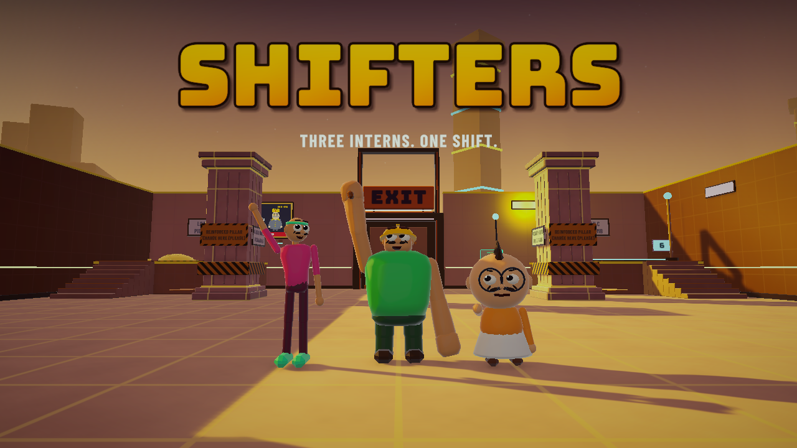
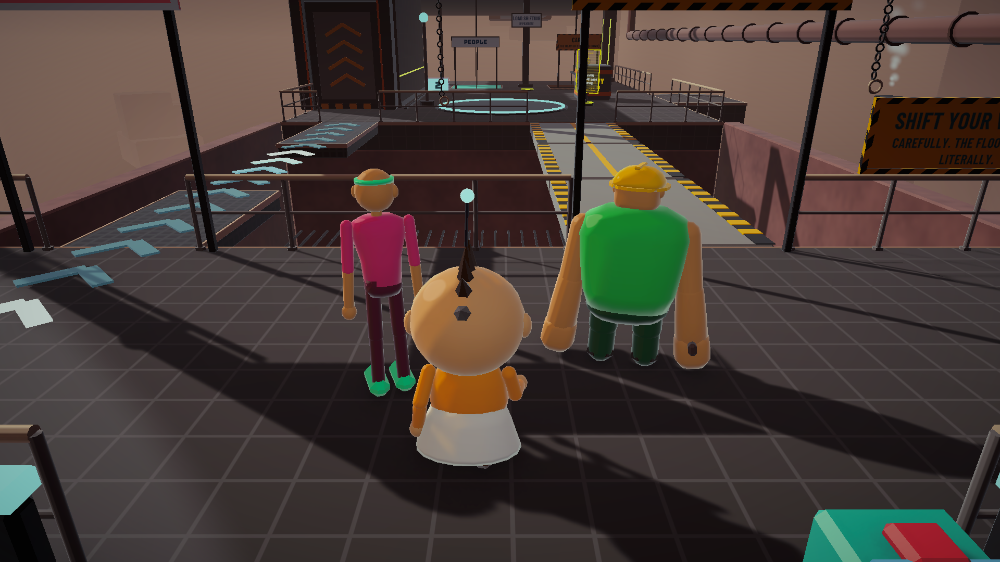
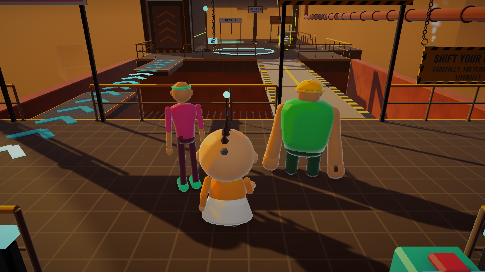
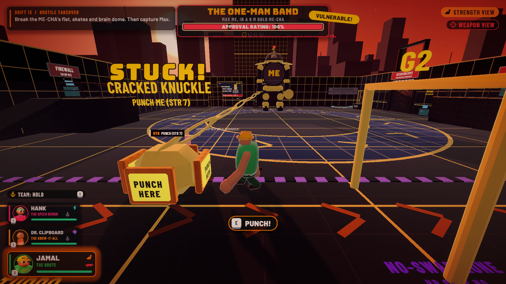
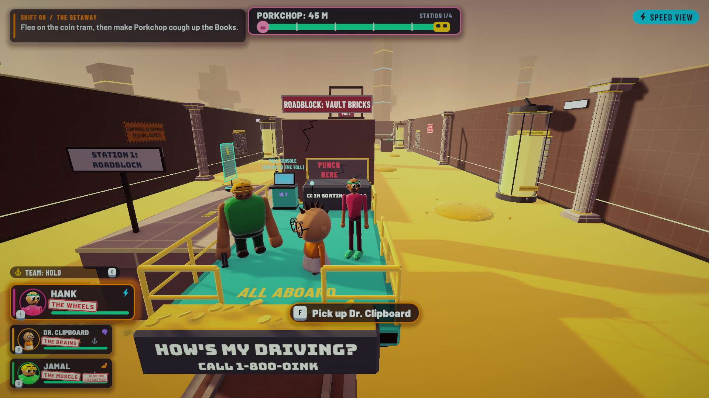
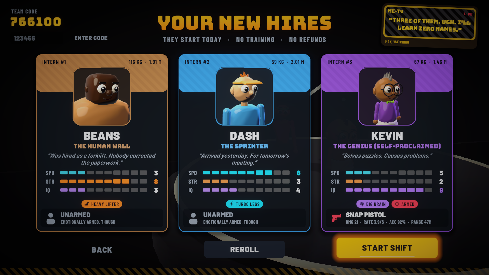

# SHIFTERS



*A chaotic 3D third-person physics puzzle game about terrible teamwork. Three random interns, one tiny tyrant, and a
world that only gets its color back when you work together.*

Made for **[GitHub Game Off 2026](https://itch.io/jam/game-off-2026)**. Theme: **SHIFT**.
Play it in the browser: `TODO (owner): itch.io page URL`

---

## How SHIFTERS uses the theme SHIFT

| Shift | In the game |
|---|---|
| **Character shift** | You control a team of three interns and shift between them at any time, with a slow-motion switch wheel (Right Shift / Tab) or directly with 1 / 2 / 3. Every puzzle needs more than one of them. |
| **Perspective shift** | Each intern literally sees a different game. The strong one sees weights, the fast one sees speed routes and timers, the smart one sees hidden clues and hologram paths. Whoever holds the gun sees what can be shot. Three of the four bosses only see the intern you are controlling, so switching away makes you invisible to them. |
| **Grey to color** | The world starts grey. Each act of teamwork brings some color back: puzzle bursts, a vault full of stolen color, and a WORLD COLOR meter that rises chapter by chapter. |
| **Work shifts** | The campaign is a work schedule. The chapters are SHIFT 01 to SHIFT 14, grouped into DAY SHIFT, SWING SHIFT, GRAVEYARD SHIFT, OVERTIME and SHIFT CHANGE. |
| **Keyboard shift** | Tools such as the BIT-SHIFTER (`<<` / `>>`), the SWAP-O-MATIC (it shifts places) and the CAPS-LOCK CANNON. |

## Screenshots

| The world starts grey (SHIFT 02) ... | ... and teamwork shifts it back to color |
|---|---|
|  |  |





## Features

* **Three interns per run.** Every team has exactly one **Brute**, one **Sprinter** and one **Brainiac**. Names, colors,
  bodies, personalities and stats are random. Each intern's main stat always rolls 7-10 and gives a perk:
  * **TURBO LEGS** (Speed): a much faster sprint, for long gaps and timed routes.
  * **HEAVY LIFTER** (Strength): heavy blocks, rusty levers, lifting and throwing teammates.
  * **BIG BRAIN** (IQ): terminals, hidden clues, hologram paths, better hints.

  The other stats roll 1-5, so every puzzle can be solved with any team.
* **Physical teamwork.** Turn an intern into a **living bridge**, stack interns, carry and throw each other, use bodies as
  counterweights on pressure plates and lifts, go limp (flop), taunt the security bots, or sacrifice an intern to hold a
  door. Lost interns are re-printed for the next shift ("Gary II"), a little worse.
* **One gun per team.** It is a random pick from ten physics guns: pistol, shotgun, laser, slingshot, Rubber Chicken
  Launcher, Gravity Plunger, Leaf Blower, T-Shirt Cannon, SAY CHEESE camera and Paint Blaster. Some chapters also have a
  locker with a designed **tool**: the BIT-SHIFTER (resizes objects), SWAP-O-MATIC (swaps places with its target), PARTY
  POPPER (a flare of light) or CAPS-LOCK CANNON (freezes things in mid-air).
* **A story campaign: "THE GREAT SHIFT".** 14 chapters with a villain, Maximilian "Max" Me, who broadcasts on ME-TV and
  has outlawed teamwork. The campaign has a bank heist, a spooky night act, four bosses and a finale in the Hall of One.
  A world-color meter tracks your progress, and three pieces of evidence (Exhibits A-C) go into your CASE FILE.
* **Skippable story.** Story scenes can be set to FULL, SHORT or OFF. In a scene, tap Enter / Space / left click for the
  next line, or hold Backspace to skip the scene.
* **Assists.** Checkpoints are everywhere, and RESTART CHECKPOINT is always in the pause menu. After three restarts of the same
  checkpoint (or four minutes stuck in one section), the pause menu offers **LET HR HANDLE IT**, which skips you to the next checkpoint (not in the finale). Bosses get gentler
  after two team wipes in the same phase (**BOSS MERCY**). Hints get better with IQ.
* **TEAM CODES.** A team code is the run's seed: enter the same code and you get the same team.
* **Free Play.** Every built level is in a grid, in full color and with no story. Best times are kept.
* **Settings.** Volumes, mouse sensitivity, invert Y, field of view, switch camera (fast or cinematic), tutorials, quality,
  fullscreen, screen shake and SHOW FPS (a small frame-rate counter). On the STORY & ASSISTS tab: story, villain heckles, spooky (FULL or MILD), color shift
  effect, HR assists and subtitle speed.
* **Everything is generated.** All 3D models, sound effects, voices and music are generated procedurally in code. The
  project has no model or audio files.

## Campaign overview

There are 14 chapters. Everything is unlocked from the start in the **SHIFT SCHEDULE**. A full run takes about
**55-60 minutes** (an estimate from bot timings; see Development).

| Act | Chapters |
|---|---|
| **ACT I: DAY SHIFT** (*"You're hired. Alone."*) | SHIFT 01 Orientation Day · SHIFT 02 The Grey Paint Factory · SHIFT 03 Performance Review (boss: THE DOWNSIZER) |
| **ACT II: SWING SHIFT** (*"The Great Color Heist."*) | SHIFT 04 Act Natural · SHIFT 05 The Back Way In · SHIFT 06 The Banker's Exam · SHIFT 07 The Federal Color Reserve · SHIFT 08 The Getaway (boss: PORKCHOP) |
| **ACT III: GRAVEYARD SHIFT** (*"Don't split up."*) | SHIFT 09 Lights Out · SHIFT 10 The ME-morial Park · SHIFT 11 Unmasked (boss: THE BOOGEYMAN) |
| **ACT IV: OVERTIME** (*"Storm the Tower."*) | SHIFT 12 Demolition Day · SHIFT 13 Hostile Takeover (boss: THE ONE-MAN BAND) |
| **FINALE: SHIFT CHANGE** | SHIFT 14 All in Favor? |

Scene mapping: SHIFT 01/02/05/06/12 are the original five levels (`L1`-`L5`). The other nine are the campaign scenes
`L6_PerformanceReview` ... `L14_AllInFavor`.
The SHIFT SCHEDULE also lists eight optional **OVERTIME (UNPAID)** side shifts. These are **not built** in this version,
so their rows are greyed out.

## Controls

Keyboard and mouse are the main controls. Gamepad bindings exist as well (right-hand column).

| Action | Keyboard / mouse | Gamepad |
|---|---|---|
| Move | W A S D | Left stick |
| Camera / zoom | Mouse / mouse wheel | Right stick (camera only, no zoom) |
| Jump | Space | A (South) |
| Sprint | Left Shift | Left stick click (toggles while moving) |
| Interact (levers, terminals, pickups, lockers) | E | X (West) |
| Grab / put down (objects and teammates) | F | Y (North) |
| Throw | Q | Right bumper |
| Fire / aim (if this intern has the gun or a tool) | Left mouse / right mouse | Right trigger / left trigger |
| Living bridge / recover | B | Left bumper |
| Flop (go limp) / get up | X | B (East) |
| Team order: follow me / hold position | G | D-pad left |
| Perspective scan | R | Right stick click |
| Hint | H | D-pad up |
| Taunt | T | D-pad right |
| **Switch wheel (character shift)** | **Right Shift** or **Tab** | D-pad down |
| Switch directly to intern 1 / 2 / 3 | 1 / 2 / 3 (also numpad) | D-pad left / up / right while the wheel is open |
| In the wheel: pick / confirm / cancel | mouse direction or 1-2-3 / Enter or left click / Esc, Right Shift or Tab | stick / A / B or D-pad down |
| **Pause** | **Esc** or **P** | Start |
| Menus: navigate / confirm / back | arrow keys or mouse / Enter or click / Esc | stick / A / B or Start |
| Story: next line | Enter, Space or left click | A |
| **Story: skip scene** | **hold Backspace** (1 s) | hold Back / View |
| Skip a tutorial popup | Backspace | Back / View |

In the browser, click the game to capture the mouse. If the browser releases the mouse (Esc, alt-tab, focus loss), the
game pauses and opens the pause menu. Choose RESUME, then click the game if it shows CLICK TO PLAY. That click only
recaptures the mouse; it does not fire.

## Opening, running and building

**Requirements:** Unity **6000.6.9f1** (Unity 6.6) with the **WebGL Build Support** module (needed only for web builds).
Packages are declared in `Packages/manifest.json` (URP 17.6.0, Input System 1.20.1, uGUI 2.6.0 with TextMesh Pro).
There is nothing else to install.

1. Open the project folder in Unity Hub with 6000.6.9f1. The first import takes a while.
2. Open `Assets/Shifters/Scenes/MainMenu.unity` and press **Play**.
   * You can also open any level scene (`L1_TrainingFacility` ... `L14_AllInFavor`) and press Play there. A random
     team is generated automatically.
3. The generated content (scenes, prefabs, materials, font assets) is committed. To rebuild it, use the **SHIFTERS**
   menu:

| Menu item | What it does |
|---|---|
| SHIFTERS → Build Everything | TMP essentials, font assets, materials, prefabs, MainMenu, sandbox + kit gallery, every catalog level that has a builder (L1-L14), then Build Settings. Writes a report to `Logs/ShiftersBuildReport.txt` |
| SHIFTERS → Build Level → L1 ... L5, L0 Sandbox, L0 Kit Gallery | Rebuilds one scene (for L6-L14, use Build Everything or the batch command below) |
| SHIFTERS → Build Main Menu Scene / Build Prefabs / Build Fonts / Bake Materials | Single steps |
| SHIFTERS → Apply Build Settings | Writes the scene list: MainMenu first, then L1-L14 |
| SHIFTERS → Check WebGL Shaders | Shader check for the web build |
| SHIFTERS → Build WebGL (itch.io) | Web build (see below) |
| SHIFTERS → Build Player (macOS) | Desktop build |

**Web build (the itch.io version):** run **SHIFTERS → Build WebGL (itch.io)**. It applies Build Settings and switches
the active platform to WebGL (URP strips shaders for the active platform). It sets the project's `Shifters` WebGL
template, 1280×720, Gzip compression with decompression fallback and data caching, then builds into `Builds/WebGL/`.
Zip the *contents* of that folder (with `index.html` at the zip root) and upload the zip to itch.io.
You can also run it in batch mode:

```sh
<Unity> -batchmode -projectPath . -executeMethod Shifters.EditorTools.ShiftersBuilder.BuildWebGL -quit [-buildPath <dir>] [-cleanBuild]
<Unity> -batchmode -projectPath . -executeMethod Shifters.EditorTools.ShiftersBuilder.BuildAll -quit
<Unity> -batchmode -projectPath . -executeMethod Shifters.EditorTools.ShiftersBuilder.BuildLevel -devLevel L7 -quit
```

The Build Settings list `MainMenu`, then `L1_TrainingFacility` ... `L14_AllInFavor` (15 scenes). The URP template's
`SampleScene` is in the list but disabled.

## Project layout

```
Assets/Shifters/
  Scripts/Core          tuning numbers (Tuning.cs), events, data, input (ShiftersInput.cs), session/save, team generator, LevelCatalog
  Scripts/Characters    interns, rigidbody motor, character manager, switch wheel logic, AI brains
  Scripts/Camera        third-person camera and switch transitions
  Scripts/Abilities     grab/throw, living bridge, flop, interaction, weight sensing
  Scripts/Puzzles       plates, levers, terminals, doors, lifts, hazards (+ PuzzleKit)
  Scripts/Weapons       gun generator, tools, lockers/armory, projectiles
  Scripts/Enemies       security bots, holding cells
  Scripts/Bosses        boss framework (arena, attacks, telegraphs, weak points, chase track)
  Scripts/Campaign      THE GREAT SHIFT: chapter catalog, director, save, assists, world-color driver
  Scripts/Story         dialogue, ME-TV broadcasts, cutscenes, villain barks, overlays, scares
  Scripts/Perspective   perspective shift system
  Scripts/Level         level flow, checkpoints, exits, tutorials, hints
  Scripts/LevelDesigns  one code-defined builder per level (L1 ... L14) + the build framework
  Scripts/Visuals       procedural low-poly characters, villain, bosses, faces, animation, portraits
  Scripts/Rendering     shader support, materials, lighting, post-processing, VFX, environment kit
  Scripts/Audio         procedural sound effects, voices and music
  Scripts/UI            menus, HUD, campaign HUD, switch wheel (built at runtime with uGUI + TextMeshPro)
  Scripts/Editor        content pipeline (SHIFTERS menu), WebGL builder, batch runners
  Scripts/Testing       automated tests, level solution bots, campaign bots, smoke/budget audits
  Art/Shaders           Shifters/StylizedLit, Hologram, GradientSky, Unlit, FxParticle, Acid (+ world-color HLSL)
  Art/Materials, Art/Meshes   baked materials and generated meshes
  Scenes, Prefabs, Resources, Fonts
Assets/WebGLTemplates/Shifters   the web page: loader, 16:9 frame, focus/pointer-lock guard, fullscreen button
```

To add a level, implement `ILevelBuilder` (`LevelIndex`, `Build(LevelBuildContext)`) in
`Scripts/LevelDesigns/L<n>/`, using the kits (`EnvKit`, `PuzzleKit`, `WeaponKit`, `BossKit`, ...), add it to
`LevelCatalog`, and run Build Everything. Gameplay numbers live in `Scripts/Core/Tuning.cs`. Levels are designed
against those numbers, which is why no random team can make a puzzle impossible.

## Development: automated testing

The game is tested by bots that actually play it, in batch-mode Play Mode, through
`Shifters.EditorTools.DevPlayRunner.Play`:

* **TeamBot level solutions** (`Shifters.L<n>Solution.Run`, `Scripts/Testing/Levels/L<n>/`) play every chapter end to
  end with real inputs and abilities, for several team seeds including the weakest and strongest rolls.
* **CampaignBot** (`Scripts/Testing/Bots/CampaignBot.cs`): `NavChain` walks all 14 chapters through the campaign
  director (routing, save, CONTINUE, chapter cards, meter, exhibits). `FullChain -campaignAct I|II|III|IV|FINALE`
  plays the real solutions in story order with one persistent team.
* **Smoke + SceneAudit** (`Shifters.EditorTools.BotBatch.SmokeAllScenes`) loads every scene and checks WebGL budgets
  (renderers, lights, rigidbodies, enemies) and sign readability.
* **Suites:** StoryTests, CampaignTests, weapon / boss / audio / UI tests.

Example (one level, three teams):

```sh
<Unity> -batchmode -projectPath . -executeMethod Shifters.EditorTools.DevPlayRunner.Play \
  -devScene Assets/Shifters/Scenes/L7_ActNatural.unity -devSetup Shifters.L7Solution.Run -devSeconds 1 -botSeeds 1,2,3 -botTeams 1,2,3
```

Status of the final build: compile is clean (editor + WebGL). All 14 chapters pass with bots. The campaign chains pass
act by act (14/14). Story and campaign suites pass 192/0 and 103/0. Smoke passes 17/17 scenes within budget. The WebGL
build boots with 0 console errors. Total bot time for the campaign is about 21 minutes.

## Known issues

* Not yet measured: frame rate in a real browser on a mid-range laptop, and human playtests. To measure it, turn on
  Settings → GAME → SHOW FPS, or open the web build with `?bench=1` (the same counter, plus a `[Bench]` line in the
  browser console every 10 s).
* In very tight spots (for example next to the gold statue in SHIFT 04) the camera can still be partly blocked by scenery.
* Each chapter opens with the chapter card followed by the level's title banner (about 3 s of double title).
* SHIFT 01 is above the renderer target (1830 vs 1600, under the 2200 cap). SHIFT 05 runs 4 active enemies (the cap).
  Both come from the original levels.
* The browser console shows a harmless URP "FSR ... stripped" warning. FSR is not used.
* The OVERTIME side shifts (L15-L22) are not built. Their rows in the SHIFT SCHEDULE are greyed out.
* There is no Quit button in the browser build (browsers can't quit). Close the tab instead.

## Credits

* **Design & development:** <AUTHOR>
* **Engine:** Unity 6 (6000.6.9f1), Universal Render Pipeline 17.6, Input System, uGUI + TextMesh Pro.
* **Art, audio and music:** all 3D models, sound effects, voices and music are generated procedurally in code by the
  project itself.
* **Fonts** (all under the SIL Open Font License 1.1):
  * **Bungee** by David Jonathan Ross, © 2023 The Bungee Project Authors. License: `Assets/Shifters/Fonts/OFL-Bungee.txt`.
  * **Barlow** and **Barlow Condensed** by Jeremy Tribby, © 2017 The Barlow Project Authors. License: `Assets/Shifters/Fonts/OFL-Barlow.txt`.
  * The web page loads copies of Bungee and Barlow Condensed from `Assets/WebGLTemplates/Shifters/TemplateData/fonts/`,
    with the same license files.
  * **Liberation Sans** (TextMesh Pro's default font, shipped by Unity), SIL OFL 1.1. License:
    `Assets/TextMesh Pro/Fonts/LiberationSans - OFL.txt`.

## License

TODO (owner): choose a license for the code and add a `LICENSE` file. The fonts keep their own SIL OFL 1.1 licenses
(see Credits).
